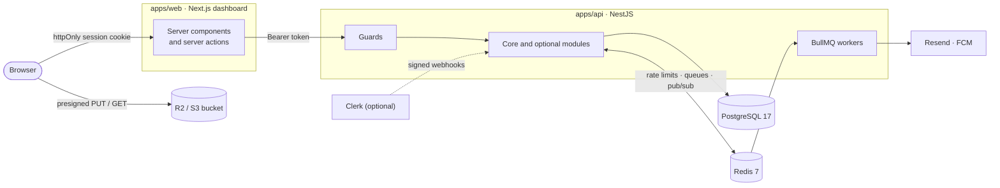

<div align="center">

# enterprise-api-starter

**A production-grade foundation for multi-tenant SaaS:**
**a NestJS API, a Next.js admin dashboard and shared Zod contracts, in one Turborepo.**

[](https://github.com/JohnGiag/multitenant-api-template/actions/workflows/ci.yml)


[](LICENSE)

[Quick start](#quick-start) · [Features](#features) · [Architecture](#architecture) · [Configuration](#configuration) · [API reference](#api-reference) · [Testing & CI](#testing--ci) · [Production checklist](#production-checklist)

</div>

---

Tenants, sign-in, roles, API keys, encrypted per-tenant secrets, rate limits, background jobs, real-time notifications, file storage and an audit log, built to the rules in [CLAUDE.md](CLAUDE.md): every query is scoped to a tenant, every list uses keyset pagination, and every page of the dashboard is checked against WCAG 2.2 AA.

## Features

| | |
|---|---|
| **Multi-tenancy** | A `tenant_id` on every tenant-owned row and in every query. UUIDv7 ids, never auto-increment. Deleting a tenant erases everything it owns, including queued jobs and files. |
| **Two auth modes** | Built-in: JWT with Argon2id passwords, and sign-in with just email and password (never a tenant ID). Or Clerk: its organizations become tenants. One setting switches the whole deployment. |
| **RBAC** | `SuperAdmin`, `TenantAdmin`, `User` and a read-only `Auditor`, denied by default and enforced by guards. |
| **API keys** | For headless clients: shown once, stored as a hash, scoped to a tenant, revocable. |
| **BYOK integrations** | Tenants bring their own Resend, Firebase or R2 credentials, encrypted with AES-256-GCM and never returned by the API. |
| **Rate limiting** | Redis sliding window per tenant, caller and tier, plus per-account login limits. Answers `429` with `Retry-After`. |
| **Background jobs** | BullMQ with retries, exponential backoff and a dead-letter queue. Workers load secrets only when a job runs. |
| **Notifications** | Server-Sent Events across all API instances (Redis Pub/Sub), plus email and push as pluggable channels. |
| **File storage** | R2 or any S3-compatible store through presigned URLs, with a per-tenant quota. File bytes never touch the API. |
| **Audit log** | Every successful write is recorded with its actor and target, and can be filtered by actor, target and time. |
| **Plug-and-play modules** | Optional modules (email, push, storage) are folders: delete one and everything still compiles. |
| **Accessible dashboard** | Next.js App Router with shadcn/ui and Radix. Tested with Playwright, with axe on every page. |

## Architecture



- **The browser never talks to the API.** Pages are server components and forms are server actions. The token sits in an `httpOnly` cookie that page scripts cannot read, so the API needs no CORS.
- **Every request passes the same guards, in order:** `AuthGuard` (who is calling; never rejects) → `RateLimitGuard` → `AccessGuard` (roles: `401`/`403`) → `TenantContextGuard` (which tenant) → handler → `AuditInterceptor` (records successful writes). They are guards, not interceptors, so a rejection is answered before an SSE stream starts.
- **Clean Architecture per module:** `domain/` (entities and ports, no framework imports), `infrastructure/` (Prisma, Redis, vendor adapters) and `presentation/` (controllers and guards).

## Quick start

**Requirements:** Node.js 22+ with Corepack (`corepack enable` provides the pinned pnpm), and Docker.

```sh
# 1. Install, start PostgreSQL and Redis, copy the env files
pnpm install
docker compose up -d --wait
cp apps/api/.env.example apps/api/.env
cp apps/web/.env.example apps/web/.env.local

# 2. Generate the two required secrets and paste them into apps/api/.env
node -e "console.log(require('crypto').randomBytes(48).toString('base64url'))"  # JWT_SECRET (32+ characters)
node -e "console.log(require('crypto').randomBytes(32).toString('base64'))"     # BYOK_MASTER_KEY (32 bytes)

# 3. Create the tables, build, seed demo accounts and start everything
pnpm --filter @repo/api db:deploy
pnpm build
pnpm --filter @repo/api db:seed-demo "a password of at least 12 characters"
pnpm dev
```

> [!IMPORTANT]
> Keep `BYOK_MASTER_KEY` safe and backed up: without it, stored tenant secrets cannot be decrypted.

Open **http://localhost:3001** and sign in with the password you chose:

| Account | Tenant | Role |
|---|---|---|
| `superadmin@example.com` | Platform | `SuperAdmin` |
| `admin@example.com` | Demo Co | `TenantAdmin` |
| `user@example.com` | Demo Co | `User` |
| `auditor@example.com` | Demo Co | `Auditor` |

The API listens on http://localhost:3000 (`PORT`), with its interactive reference at **http://localhost:3000/docs**.

## Commands

| Command | What it does |
|---|---|
| `pnpm dev` | Builds the shared types, then runs the API in watch mode and the dashboard on port 3001 |
| `pnpm build` | Builds every package |
| `pnpm lint` | Lints the dashboard (ESLint with the Next.js and `jsx-a11y` accessibility rules) |
| `pnpm typecheck` | Type-checks every package |
| `pnpm test` | Builds, then runs the unit tests and the API end-to-end tests (needs PostgreSQL and Redis) |
| `pnpm test:e2e` | Dashboard end-to-end tests with Playwright and axe (see [Testing & CI](#testing--ci)) |
| `pnpm coverage` | Like `pnpm test` for the API, plus a coverage report per source file |
| `pnpm --filter @repo/api db:deploy` | Applies the database migrations |
| `pnpm --filter @repo/api db:migrate` | Creates and applies a migration after a schema change (development) |
| `pnpm --filter @repo/api db:seed-demo "<password>"` | Creates the demo accounts above. Local only: refuses to run with `NODE_ENV=production`, needs `pnpm build` first, and changes nothing when run again |
| `pnpm --filter @repo/api test:live` | Opt-in: sends one real email through Resend to its `delivered@resend.dev` test address (see below) |

<details>
<summary>About <code>test:live</code></summary>

It sends one email with `RESEND_PLATFORM_KEY` to Resend's `delivered@resend.dev` test address, which has no real inbox. With a dev-only full-access key in `RESEND_PLATFORM_FULL_ACCESS_KEY` (never used by the app, and not in `.env.example`), it also confirms delivery through Resend's API. `pnpm test` never sends real email.

</details>

## Configuration

Each app reads its own env file: `apps/api/.env` and `apps/web/.env.local`. Both `.env.example` files explain every variable.

<details open>
<summary><b>API</b> (<code>apps/api/.env</code>)</summary>

| Variable | Required | Purpose |
|---|---|---|
| `DATABASE_URL` | yes | PostgreSQL connection string |
| `REDIS_URL` | yes¹ | Redis for rate limits, queues and real-time events |
| `JWT_SECRET` | local mode | Signs access tokens, at least 32 characters |
| `BYOK_MASTER_KEY` | yes | 32 bytes, base64. Encrypts tenant secrets; never logged |
| `AUTH_PROVIDER` | | `local` (default) or `clerk` |
| `PORT` | | Default `3000` |
| `API_DOCS` | | `true` or `false`: Swagger UI at `/docs`. On by default, off when `NODE_ENV=production` unless `true` |
| `APP_URL` | for emails | The dashboard's address, used in invitation and reset links |
| `RESEND_PLATFORM_KEY` / `RESEND_PLATFORM_FROM` | for emails | Platform credentials for system emails. Without the key, invitations answer `503` |
| `TRUST_PROXY_HOPS` | | Number of proxies in front of the API, so rate limits see the real client IP. Default `0` |
| `DASHBOARD_PROXY_SECRET` | | Shared with the dashboard, at least 32 characters (see [Rate limiting](#rate-limiting)) |
| `CLERK_ISSUER`, `CLERK_WEBHOOK_SECRET`, `CLERK_AUTHORIZED_PARTIES` | Clerk mode | See [Clerk mode](#clerk-mode) |
| `STORAGE_ENDPOINT`, `STORAGE_BUCKET`, `STORAGE_ACCESS_KEY_ID`, `STORAGE_SECRET_ACCESS_KEY`, `STORAGE_REGION` | | The platform bucket. Set all of them or none; `STORAGE_REGION` is optional |
| `JOB_ATTEMPTS`, `JOB_BACKOFF_MS`, `WORKER_CONCURRENCY`, `DLQ_MAX_ENTRIES`, `QUEUE_PREFIX` | | Job tuning. Defaults: 3, 1000 ms, 5, 10 000 and `bull` |

¹ For Redis high availability, set `REDIS_SENTINELS` and `REDIS_SENTINEL_NAME` (plus `REDIS_PASSWORD` if needed) instead.

</details>

<details open>
<summary><b>Dashboard</b> (<code>apps/web/.env.local</code>)</summary>

| Variable | Required | Purpose |
|---|---|---|
| `API_URL` | yes | Where the dashboard's server reaches the API. Never sent to browsers |
| `AUTH_PROVIDER` | | The same value as the API's |
| `NEXT_PUBLIC_CLERK_PUBLISHABLE_KEY`, `CLERK_SECRET_KEY` | Clerk mode | The secret key stays on the dashboard's server |
| `TRUST_PROXY_HOPS` | | Number of proxies in front of the dashboard. Default `0` |
| `DASHBOARD_PROXY_SECRET` | production | The API's value, the same one. The dashboard refuses to start in production without it |

> [!NOTE]
> Set `AUTH_PROVIDER` and the Clerk keys when **building** the dashboard too: Next.js bakes `NEXT_PUBLIC_*` values and static pages in at build time.

</details>

## Roles and permissions

Access is denied by default: a route answers only the roles it lists, and `SuperAdmin` is never implied.

| | `SuperAdmin` | `TenantAdmin` | `User` | `Auditor` |
|---|:---:|:---:|:---:|:---:|
| Tenants: create, change tier, delete, open any | ✅ | — | — | — |
| Rename own tenant | ✅ | ✅ | — | — |
| Members and invitations | ✅¹ | ✅ | — | 👁 |
| API keys | — | ✅ | — | 👁 |
| Integrations (BYOK secrets) | — | ✅ | — | 👁 masked |
| Send notifications | — | ✅ | — | — |
| Files: upload, download, delete | — | ✅ | ✅² | 👁 download |
| Audit log | 👁 platform log | 👁 | — | 👁 |
| Own password and notifications | ✅ | ✅ | ✅ | ✅ |

✅ manage · 👁 read only · ¹ through `X-Tenant-Id` · ² deletes only their own uploads

- **`SuperAdmin` manages tenants and their users, nothing inside them.** It never sees a tenant's secrets, messages, files or audit log, not even with `X-Tenant-Id`.
- **No one becomes `SuperAdmin` through the API,** and `SuperAdmin` accounts cannot be changed or removed through it. Create the first one in the database: locally `db:seed-demo` does it; in production, insert it with an Argon2id `password_hash` ([Clerk mode](#clerk-mode) has its own steps).
- **A tenant always keeps at least one `TenantAdmin`.** A change that would remove the last one answers `409`, even when two admins demote each other at the same moment.
- Role changes and removals apply when the user's current token expires, within 15 minutes. In Clerk mode they apply at once.

## Authentication

### Built-in (`AUTH_PROVIDER=local`)

- **Sign-in needs only email and password.** `POST /v1/auth/login` returns a 15-minute JWT: send it as `Authorization: Bearer <token>`.
- **One email, several tenants:** emails are unique per tenant. When the password matches accounts in several tenants, the answer is `{ tenants: [{ id, name }] }` and the client signs in again with the chosen `tenantId`. Only tenants whose account accepted the password are listed, so the answer reveals nothing without it.
- **API keys** (`X-API-Key: <key>`) are for a tenant's own servers and scripts. Not to be confused with the BYOK keys under Settings.

### Users and invitations

People join by invitation only, and choose their own password. There is no sign-up.

- **Invitations** email a single-use link to `APP_URL/accept-invitation?token=…`, valid for 7 days. Inviting the same email again replaces the pending invitation, and resending voids the old link.
- **Forgotten passwords:** a request always answers `202`, whether or not the email has accounts. Each account with that email gets its own 1-hour link, naming its tenant. Setting the new password also lifts any login lockout.
- **System emails always use the platform's credentials** (`RESEND_PLATFORM_KEY`), never a tenant's own Resend account: whoever controls the sending account could read the links in its logs. Tenant Resend integrations are for notifications only.
- **Only SHA-256 hashes of these tokens are stored.** If the email fails, the invitation is not kept (`502`).
- **Passwords** need at least 12 characters and are hashed with Argon2id. Wrong current-password guesses count towards the login limit.

### Clerk mode

With `AUTH_PROVIDER=clerk`, people and organizations live in Clerk and the API mirrors them through signed webhooks. **Each Clerk organization is one tenant**, and each membership is one user of that tenant.

<details>
<summary><b>Set up Clerk mode</b></summary>

1. **API** (`apps/api/.env`): set `AUTH_PROVIDER=clerk`, `CLERK_ISSUER` (your Frontend API URL), `CLERK_WEBHOOK_SECRET` and `CLERK_AUTHORIZED_PARTIES` (the dashboard's origin).
2. **Dashboard** (`apps/web/.env.local`): set `AUTH_PROVIDER=clerk`, `NEXT_PUBLIC_CLERK_PUBLISHABLE_KEY` and `CLERK_SECRET_KEY`.
3. **Webhooks:** in the Clerk dashboard, enable Organizations and add an endpoint at `<api>/v1/auth/clerk/webhook` for `organization.created`, `organization.updated`, `organization.deleted`, `organizationMembership.created`, `organizationMembership.deleted`, `user.updated` and `user.deleted`. Locally, relay them with `clerk webhooks listen --forward-to http://localhost:3000/v1/auth/clerk/webhook`.
4. **Invitation only:** set **Restrictions → Sign-up mode → Restricted**. Under **Organizations → Settings**, turn off letting users create organizations (each one becomes a tenant) and letting admins delete theirs (that erases the tenant and all its data).
5. **First SuperAdmin:** create the platform organization in Clerk and join it. Once the webhooks have mirrored it, set that user's `role` to `SuperAdmin` in the database.

</details>

- **What Clerk owns:** sign-in, passwords, invitations, membership, and creating, renaming and deleting tenants. Those API routes answer `409`, and the dashboard hides their screens.
- **What stays ours:** roles after someone joins (a new `org:admin` starts as `TenantAdmin`, anyone else as `User`), tiers, API keys, integrations, notifications and rate limits.
- **Requests** carry Clerk's session token, verified against Clerk's published keys. Its active organization picks the tenant. A token with no active organization, or for one not mirrored yet, gets `401`.
- **Webhooks** are verified (Svix signature, 5-minute window) and may arrive in any order or more than once. Deleting an organization deletes its tenant and all its data, except the platform tenant, which is never deleted.
- **The dashboard** shows Clerk's sign-in (sign-up turned off), asks for an organization when none is active, and explains instead of looping when the API doesn't know the user yet. The header shows Clerk's organization switcher and account menu; a `SuperAdmin` keeps the tenant switcher. Clerk's secret key stays on the dashboard's server.

## Multi-tenancy

- **Every request acts on the caller's own tenant.** A `SuperAdmin` may target another one with `X-Tenant-Id`; anyone else sending a different id gets `403`.
- **Deleting a tenant erases everything it owns:** users, invitations, API keys, integrations and audit records, plus its queued and dead-lettered jobs and its files in the platform bucket.
- **The platform tenant**, the one holding the `SuperAdmin` accounts, can never be deleted, neither through the API nor by deleting its Clerk organization.
- **Pagination is keyset-based everywhere** (`?cursor=&limit=`), backed by indexes that start with `tenant_id`. Deep pages cost the same as the first.

## Rate limiting

Every route is limited with a Redis sliding window over the last 60 seconds, with no opt-in needed. Responses carry `X-RateLimit-Limit`, `X-RateLimit-Remaining` and `X-RateLimit-Reset`. Over the limit, the API answers `429` with `Retry-After` (seconds).

| Caller | Bucket | Limit | If Redis is down |
|---|---|---|---|
| Signed-in user or API key | per tenant and caller | per minute: `free` 120, `pro` 600, `enterprise` 3000 | served, unmetered |
| Unauthenticated (e.g. sign-in) | per client IP and route | 100 per minute | `503` |
| Sign-in attempts | per email (any tenant), or per account when a `tenantId` is sent; from any IP | 10 per 15 minutes; a success resets it | `503` |
| Password reset requests | per email | 10 per 15 minutes | `503` |

**Client IPs.** Behind a load balancer, set `TRUST_PROXY_HOPS` to the number of proxies in front of the API.

**Per browser behind the dashboard.** Sign-in, invitation and reset requests reach the API from the dashboard's server, so by default every browser shares its one bucket. To limit per browser instead:
1. Set the same `DASHBOARD_PROXY_SECRET` (32+ characters) in both apps.
2. In `apps/web`, set `TRUST_PROXY_HOPS` to the number of proxies in front of the dashboard.

The dashboard then forwards each browser's IP (`X-Client-Ip` with `X-Dashboard-Secret`), and the API believes it only when the secret matches. With no proxy in front of the dashboard (`0`), nothing is forwarded, because a browser can write `X-Forwarded-For` itself.

## Notifications and background jobs

- **Real-time:** `GET /v1/notifications/stream` is a Server-Sent Events stream of the caller's own notifications, fanned out through Redis Pub/Sub so it works across any number of API instances. A user may hold 5 open streams per instance; a 6th closes the oldest with a final `closed` event. Browsers' `EventSource` cannot send an `Authorization` header: use a fetch-based client, or the dashboard's relay at `/notifications/stream`.
- **Email and push** (optional modules `email` and `push`) are delivered by BullMQ workers, one job per channel. Every API instance runs a worker (`WORKER_CONCURRENCY` jobs at a time). The worker loads the tenant's secrets when the job runs; job payloads never contain them.
- **Missing pieces are skipped, not failed:** a channel whose module is removed, or that the tenant has not configured or has disabled, is skipped.
- **Retries and the dead-letter queue:** failures are retried with exponential backoff (`JOB_ATTEMPTS`, `JOB_BACKOFF_MS`). Errors a retry cannot fix, such as rejected credentials, skip the retries. Jobs that still fail land in `notifications-dlq` with their payload, error and every attempt's stack trace, ready to inspect and replay.

## File storage

Optional module `storage`, for Cloudflare R2 or any S3-compatible store.

- **File bytes never pass through the API.** It hands out presigned URLs valid for 15 minutes, and the browser uploads and downloads directly. The API still decides who may upload, where (keys are `<tenantId>/<random>/<filename>`) and how much: the exact size, at most 1 MB (`MAX_UPLOAD_BYTES`), is signed into the URL.
- **Downloads are always served as attachments,** never rendered, so an uploaded HTML file cannot run in the browser.
- **Platform bucket** (`STORAGE_*`): for tenants without their own, with a quota of 100 MB and 1,000 files per tenant (`PLATFORM_QUOTA`). The quota counts each upload URL issued, whether or not the file was sent; deleting the file frees it.
- **The tenant's own bucket:** configured as the `r2` integration, with no quota. Its files are not tracked or listed, and the API never sends requests to a tenant-chosen endpoint.
- **Deleting** a file is for its uploader or a `TenantAdmin`. Deleting a tenant also deletes its platform-bucket files.

> [!IMPORTANT]
> **Browser uploads need a CORS rule on every bucket**, the platform's and each tenant's own. In R2: bucket → Settings → CORS policy.
> ```json
> [{ "AllowedOrigins": ["https://your-dashboard.example"], "AllowedMethods": ["PUT", "GET"], "AllowedHeaders": ["content-type"], "MaxAgeSeconds": 3600 }]
> ```

## Audit log

- **Every successful write** (`POST`, `PUT`, `PATCH`, `DELETE`) by a signed-in user or API key is recorded: the actor (kind, id, role), the route pattern, the `:id` target, the status and, when a `SuperAdmin` acted on another tenant, which one. Ids only: no request bodies, raw URLs or personal data.
- **Two public routes are recorded too,** with the user as the actor: accepting an invitation and confirming a password reset. Reads, rejected requests, sign-ins and webhooks are not.
- **Rows live in the actor's own tenant,** so a `SuperAdmin`'s actions survive the deletion of the tenant they acted on. A `SuperAdmin` reads only that platform log.
- **Filter by actor, target and time,** page by page. In the dashboard, every actor or target id links to its filtered view.

## Modules and integrations

- **Optional modules** live in `apps/api/src/optional/<key>/` (email, push and storage today). Delete a module's folder to uninstall it: nothing else imports it, and an architecture test enforces that.
- **`GET /v1/system/capabilities`** reports which modules are installed and enabled for the tenant. The dashboard's Settings page shows one tab per module that takes tenant configuration. Known providers (`resend`, `fcm`, `r2`) get a form, and a module added later gets a JSON editor, with no dashboard change.
- **BYOK secrets** are stored encrypted with AES-256-GCM, with a random IV each time and bound to their tenant and provider. Only masked values ever leave the API. Only providers used by an installed module are accepted.

## Dashboard

`apps/web`: Next.js (App Router), Tailwind CSS and shadcn/ui (Radix), built to WCAG 2.1/2.2 AA.

| Page | Who | What |
|---|---|---|
| Overview | everyone | Tenant, tier, role and installed features |
| Tenants | `SuperAdmin` | Create, rename, change tier, delete (type the name to confirm), and **Open** any tenant |
| Users | `TenantAdmin`, `SuperAdmin`, `Auditor` reads | Members (change role, remove) and invitations (invite, resend, revoke) |
| API keys | `TenantAdmin`, `Auditor` reads | Create (shown once, with a copy button) and revoke |
| Files | while `storage` is enabled | Upload straight to the bucket, download, delete |
| Notifications | everyone | Live feed of your own notifications; a `TenantAdmin` can send |
| Audit log | `TenantAdmin`, `Auditor`, `SuperAdmin` | Filterable list of recorded actions |
| Settings | everyone | Tenant name, and one tab per configurable module |
| Account | everyone | Your role, and changing your password (local mode) |

- **Session:** an `httpOnly`, `SameSite=Lax` cookie (`Secure` in production). When the 15-minute token expires, the next request goes back to `/login`. `getToken()` in `src/lib/session.ts` is the one place that knows where the token comes from.
- **Live notifications:** the browser's `EventSource` connects to the dashboard's `/notifications/stream`, which adds the token and relays the API's stream. There is no history: only what arrives while the page is open.
- **Tenant switcher:** a `SuperAdmin` picks the tenant to act on (sent as `X-Tenant-Id`). Everyone else sees their own tenant's name, or Clerk's organization switcher in Clerk mode.
- **Languages:** English and Greek. The text lives in the API's `translations` table (one row per language and key) and comes from the public `GET /v1/translations/:locale`, which falls back to English for keys a language lacks. The dashboard caches it for a minute, so an edit in the table shows without a deploy. The language switcher stores the choice in a `locale` cookie; without one, the browser's `Accept-Language` decides. To add a language: list it in `LOCALES` (`packages/shared-types/src/i18n.ts`) and insert its rows in a migration. Clerk's own widgets and the API's error messages stay in English.

## API reference

**Interactive docs: http://localhost:3000/docs** (Swagger UI) · machine-readable: **`/docs/openapi.json`** (OpenAPI 3.0, ready for client generators and Postman).

Every route is there with its request and response schemas, the roles allowed to call it, its credentials, and the errors it can answer. Use **Authorize** to paste a token or an API key and try requests from the browser.

**It cannot drift from the code.** The document is generated at startup from what the routes already declare:

| Part of the document | Comes from |
|---|---|
| Bodies, query strings, path parameters | The Zod schemas the routes validate with (`packages/shared-types`) |
| Roles, credentials, `X-Tenant-Id` | `@Roles`, `@Public` and `@TenantId()`, the same metadata the guards enforce |
| Success status | `@HttpCode`, or the method's default |
| `400`, `401`, `403`, `409`, `429` | Validation, access rules, Clerk mode, rate limiting |
| Summary and response schema | `@ApiDoc(summary, ResponseSchema)` on each route |

A route without `@ApiDoc` stops the document from building, and a test checks that every route the server routes is documented. Docs are on by default and off in production unless `API_DOCS=true`.

| Group | Routes under `/v1` |
|---|---|
| auth | `/auth/login`, `/auth/me`, `/auth/password-reset`, `/auth/clerk/webhook` |
| tenants · users · invitations | `/tenants`, `/users`, `/invitations` |
| api-keys · integrations | `/api-keys`, `/integrations/{provider}` |
| notifications · push | `/notifications`, `/notifications/stream`, `/push/devices` |
| storage | `/storage/uploads`, `/storage/downloads`, `/storage/objects` |
| audit-logs · system | `/audit-logs`, `/system/capabilities` |

**Common status codes:** `400` invalid input · `401` not signed in · `403` not allowed · `404` not found or another tenant's · `409` conflict, or managed in Clerk · `429` rate limited · `502`/`503` an email or storage provider failed or is not configured.

## Testing & CI

| Suite | Command | What it covers |
|---|---|---|
| Unit | `pnpm test` | Domain rules: access policy, crypto, keyset pagination, rate-limit plans, parsers |
| API end-to-end | `pnpm test` | Every endpoint against real PostgreSQL and Redis, including tenant isolation, Clerk webhooks (offline), Redis outages, index usage (`EXPLAIN`) and the OpenAPI document covering every route |
| Dashboard end-to-end | `pnpm test:e2e` | Playwright (Chromium) through the real API: sign-in (including keyboard only), the main flows per role, and **axe on every page** (WCAG 2.2 AA) |

- **`pnpm test:e2e`** starts the built API and a local-mode build of the dashboard on ports 3100 and 3101, so your dev servers keep running. It seeds its own tenants and deletes them afterwards. The first time, install the browser: `pnpm --filter @repo/web exec playwright install chromium`.
- **CI** ([`.github/workflows/ci.yml`](.github/workflows/ci.yml)) runs on every push to `main` and every pull request: install with a frozen lockfile, migrations, lint, typecheck, `pnpm test` and `pnpm test:e2e`, against PostgreSQL 17 and Redis 7 service containers.
  - **No repository secrets needed:** the workflow sets the database and Redis URLs, and generates throwaway `JWT_SECRET` and `BYOK_MASTER_KEY` values for each run.
  - **On failure,** the Playwright report with traces is attached to the run for 7 days.
  - **Not in CI:** Clerk mode and real emails. Without `STORAGE_*`, the Files page's accessibility check is skipped.

## Security and compliance

Built towards ISO 27001 (access control, encryption, audit logs), ISO 27701 (minimal, tenant-scoped personal data) and ISO 42001 (AI features must record model, input, output and actor).

- **Secrets:** passwords hashed with Argon2id; API keys stored only as SHA-256 hashes, found by a non-secret prefix and compared in constant time; emailed tokens stored only as SHA-256 hashes and single use; tenant secrets encrypted with AES-256-GCM and never returned.
- **Isolation:** tenant scoping in every query, and a test for every tenant-scoped repository proving one tenant cannot read or write another's data.
- **Logs:** never contain secrets, tokens, passwords or full personal data. Rate-limit keys hash emails.
- **Outbound calls** all have timeouts, so a hung provider cannot hold a worker.

## Production checklist

- [ ] Generate a strong `JWT_SECRET` and `BYOK_MASTER_KEY`, store them in a secret manager, and back up `BYOK_MASTER_KEY`.
- [ ] Use a **send-only** Resend key for `RESEND_PLATFORM_KEY`: a full-access key can read sent emails, including their links. Send from a verified domain (`RESEND_PLATFORM_FROM`).
- [ ] Set `APP_URL` to the dashboard's public address.
- [ ] Set `TRUST_PROXY_HOPS` to the number of proxies in front of the API, and never more.
- [ ] Set `DASHBOARD_PROXY_SECRET` in both apps, and the dashboard's `TRUST_PROXY_HOPS`, so sign-in is limited per browser.
- [ ] Add a CORS rule for the dashboard's origin on every storage bucket.
- [ ] Create the first `SuperAdmin`, and keep at least two.
- [ ] Clerk mode: sign-up Restricted, and no organization creation or deletion by users.
- [ ] Make the `ci` check required for `main` (GitHub → Settings → Branches).

## Project structure

```
apps/
  api/                    NestJS API
    src/modules/          core: auth, tenancy, users, integrations, rate-limit, jobs, notifications, audit, mail, system
    src/optional/         plug-and-play modules: email, push, storage
    prisma/               schema and migrations
    test/                 unit and end-to-end tests
  web/                    Next.js admin dashboard
    src/app/              pages and server actions
    e2e/                  Playwright and axe tests
packages/
  shared-types/           Zod schemas and types shared by the API and the dashboard
.github/workflows/ci.yml  CI
CLAUDE.md                 the engineering rules every change follows
LICENSE                   MIT
```

## Contributing

Build one feature at a time, keep every step compiling, and follow the rules in [CLAUDE.md](CLAUDE.md): tenant scoping, keyset pagination, Zod validation at the boundary, guards before handlers, and WCAG 2.2 AA in the dashboard.

## License

[MIT](LICENSE) © 2026 Giannis Giagkoudis
